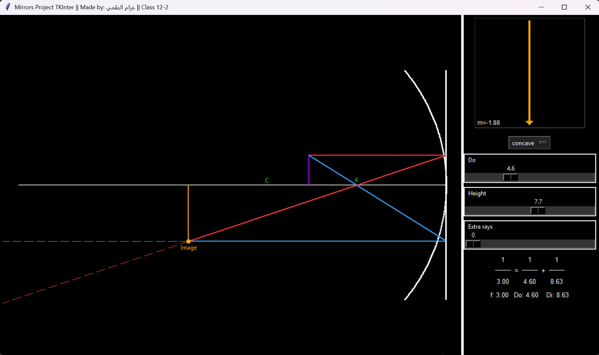
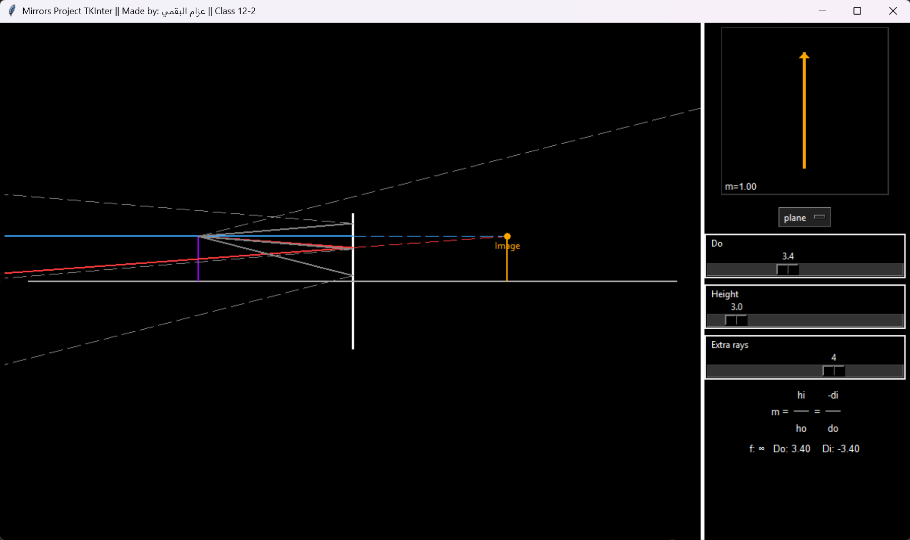
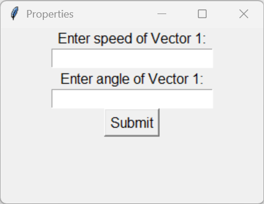
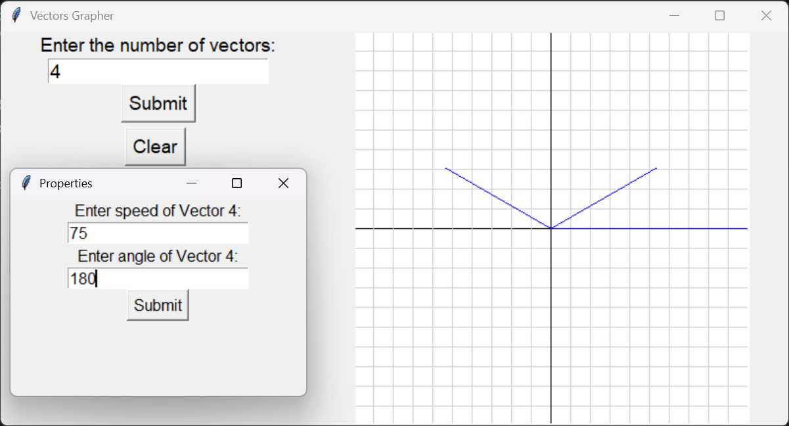
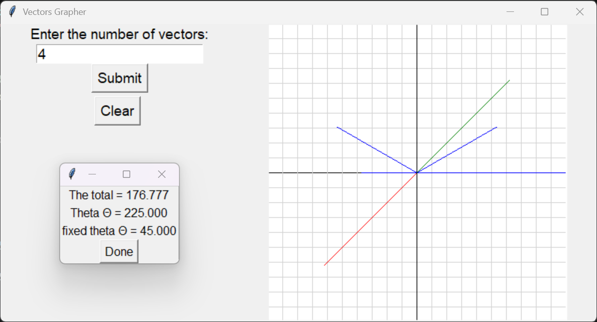

# Python Physics Projects

(-_-)

My two interactive Python projects that I built to explore physics visually: **reflection in mirrors** and **vector addition**. Both of these use Tkinter, so they can be run as normal desktop applications without requiring an internet browser or online service.

| Project | What it investigates | Interface |
| --- | --- | --- |
| [Mirror and Ray Diagram Simulator](physics%20mirror%20school%20project.py) | Concave and plane mirrors, reflected rays, image formation | Desktop GUI |
| [Vector Addition Visualizer](physics%20vectors%20school%20project.py) | Vector components, resultant magnitude, and direction | Desktop GUI |

## Getting started

Install **Python 3** with Tkinter available, then download or clone this repository. Run any of the programs from the directory where you saved the files:

```bash
python "physics mirror school project.py"
python "physics vectors school project.py"
```

On Windows, you can also run `py` instead of `python`. Both scripts use Python's standard library (`tkinter` and `math`; the mirror tool uses `sys` and `traceback` as well). **There is no `requirements.txt` to install.** Some Linux distributions require you to install Tkinter separately (generally `python3-tk`).

---

## 1. Mirror and Ray Diagram Simulator

**File:** [`physics mirror school project.py`](physics%20mirror%20school%20project.py)

This interactive project allows you to move the object and observe the reflection of the rays on a **concave** or **plane** mirror. The large black area depicts the mirror, rays, and image location, while the smaller preview shows the image orientation and magnification.

### What you can do

- Toggle between concave and plane mirror settings.
- Drag the **Do** (Object Distance) slider to move the object.
- Adjust the mirror's displayed **Height** and add **Extra rays**.
- Observe the paths of the reflected rays and the locations of the focal point and center, where relevant.
- Read the focal length, object distance, and image distance from the interface.
- Compare the ray diagram to the magnification preview.

### How to use

1. Run `python "physics mirror school project.py"`.
2. Select **concave** or **plane** from the menu.
3. Change **Do** to move the object.
4. Adjust **Height** and **Extra rays** to explore the diagram.
5. Observe how the drawn rays and computed image change.

### What the simulator looks like

**Concave mirror:** The reflected rays, focal point (F), center of curvature (C), and calculated image are shown. The preview on the right shows the orientation of the image and its magnification.



**Plane mirror:** The diagram demonstrates the incident and reflected rays and the lines of their respective extensions toward a virtual image situated behind the mirror.



### Physics notes

For the concave mirror, the script assumes a fixed radius (R) and uses the mirror equation **1/f = 1/Do + 1/Di**, with **f = R/2**. The sign and position of the image change depending on the object distance. The plane mirror mode considers the image virtual, at the corresponding distance behind the mirror.

This is a classroom-style visualizer, not a full optical ray-tracing engine. Some of the drawn rays are constructions, and extreme settings may cause portions of the diagram to extend outside the canvas.

---

## 2. Vector Addition Visualizer

**File:** [`physics vectors school project.py`](physics%20vectors%20school%20project.py)

Input magnitudes and angles of multiple vectors to graph them and see their decomposed horizontal and vertical components. The tool sums these components to calculate the overall magnitude and angle of the resultant vector.

### What you can do

- Choose how many vectors to enter.
- Input the magnitude of each vector (labeled **speed** in the app) and its angle in degrees.
- Illustrate the individual vectors on a coordinate grid, starting from the origin.
- Calculate the sum of the horizontal (**Rx**) and vertical (**Ry**) components.
- Display the resultant magnitude and direction, alongside a line drawn in the opposite direction.
- Clear the data to start again.

### How to use

1. Run `python "physics vectors school project.py"`.
2. Enter the **number of vectors** and click on **Submit**.
3. In the following window, type in the **speed/magnitude** and **angle** of each vector.
4. Continue until all vectors are entered.
5. Analyze the grid, the resultant arrows, and the result window. Select **Clear** to reset.

### What the vector tool looks like

**1. Fill in each vector:** The properties window requires you to fill in the magnitude (labeled speed in this case) and its angle.



**2. Watch the graph build:** Each new vector you add causes another line to appear on the coordinate grid. In this screenshot, the graph is shown while the fourth vector is being entered.



**3. View the calculated result:** The resultant magnitude and angles are displayed along with the finished graph after the last vector.



### Physics notes and limitations

The calculation breaks each vector into horizontal and vertical components using **x = magnitude × cos(angle)** and **y = magnitude × sin(angle)**. It then adds the components and uses **R = √(Rx² + Ry²)** and **atan2(Ry, Rx)** to calculate the resultant magnitude and direction.

The current input validation only accepts **whole-number, nonnegative values** for the magnitudes and angles. As such, negative angles and decimal inputs are rejected. The interface also reports an angle offset by 180°, so pay attention to which arrow and direction you are considering.

This project is educational, not a precision measurement tool.

---

## About these projects

I created these programs just to play around with physics in something other than the static diagrams in our textbooks. Moving a slider or putting in a few more vectors makes it much easier to relate the equations to what you see on the screen.

They are kept in separate files so you can open, study, or change either project without having to open the other one. Both programs run locally once you have Python/Tkinter set up.

## License

A license has not been specified for this repository yet. Add a `LICENSE` file if you want to specify the reuse and distribution rights of your project.
