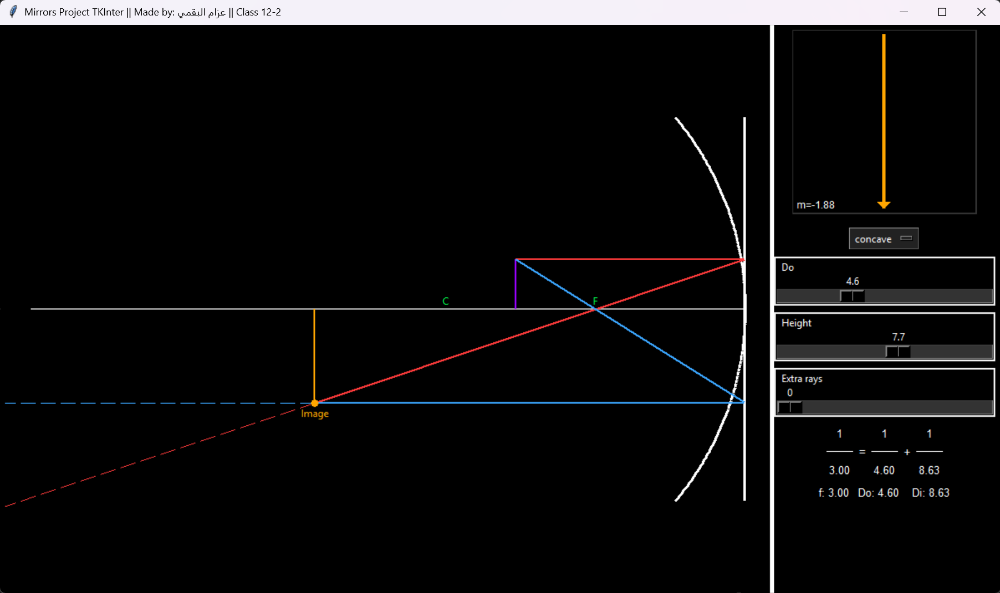
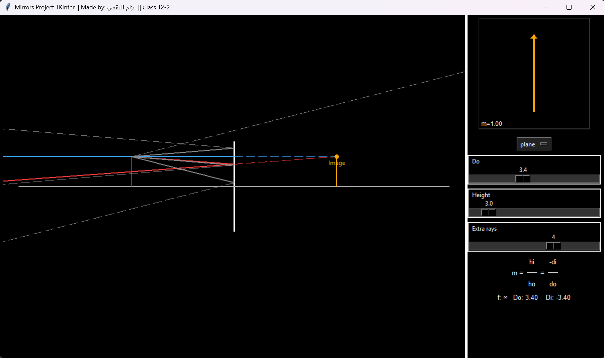
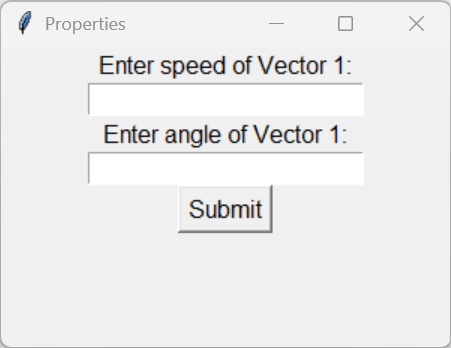
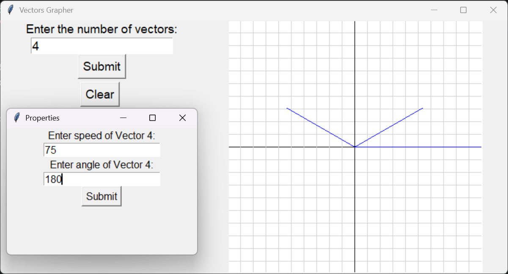
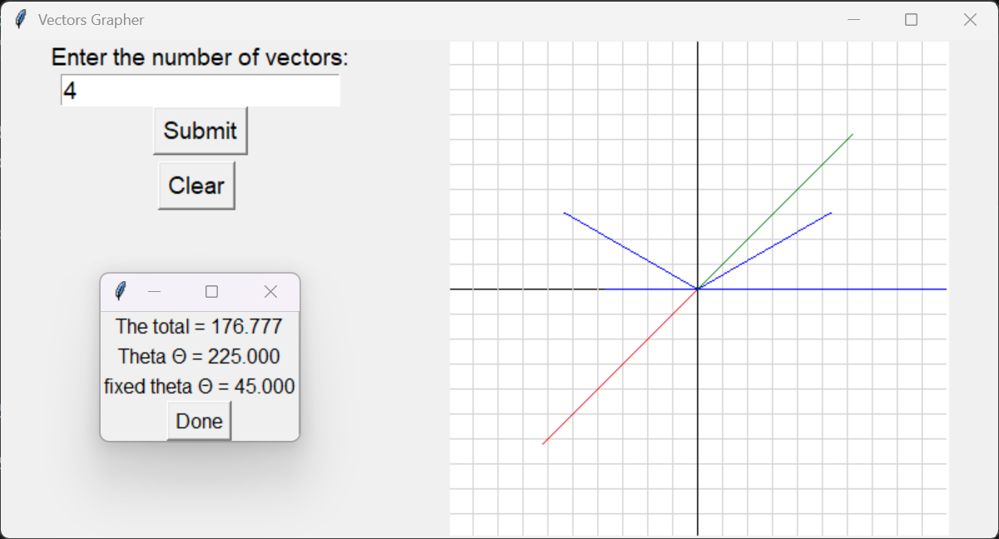

# Python Physics Projects

Two interactive Python projects I built to explore physics visually: **reflection in mirrors** and **vector addition**. Both use Tkinter, so you can run them as desktop applications without a browser or online service.

| Project | What it explores | Interface |
| --- | --- | --- |
| [Mirror and Ray Diagram Simulator](physics%20mirror%20school%20project.py) | Concave and plane mirrors, reflected rays, image formation | Desktop GUI |
| [Vector Addition Visualizer](physics%20vectors%20school%20project.py) | Vector components, resultant magnitude, and direction | Desktop GUI |

## Getting started

Install **Python 3** with Tkinter available, then download or clone this repository. Run either program from the folder where you saved the files:

```bash
python "physics mirror school project.py"
python "physics vectors school project.py"
```

On Windows, you can also use `py` instead of `python`. Both scripts use Python's standard library (`tkinter` and `math`; the mirror tool also uses `sys` and `traceback`). **There is no `requirements.txt` to install.** Some Linux installations require Tkinter to be installed separately (commonly `python3-tk`).

---

## 1. Mirror and Ray Diagram Simulator

**File:** [`physics mirror school project.py`](physics%20mirror%20school%20project.py)

This project lets you change the position of an object and watch how its rays interact with a **concave** or **plane** mirror. The main black canvas draws the mirror, rays, and image location; a smaller preview shows the image orientation and magnification.

### What you can do

- Switch between concave and plane mirror modes.
- Move the object using the **Do** (object distance) slider.
- Adjust the mirror's displayed height and add extra rays.
- See the reflected ray paths, focal point and center labels where relevant.
- Read the focal length, object distance, and image distance from the interface.
- Compare the ray diagram with a magnification preview.

### How to use

1. Run `python "physics mirror school project.py"`.
2. Choose **concave** or **plane** from the menu.
3. Change **Do** to move the object.
4. Adjust **Height** and **Extra rays** to explore the diagram.
5. Watch how the drawn rays and calculated image change.

### What the simulator looks like

**Concave mirror:** The diagram displays reflected rays, the focal point (F), center of curvature (C), and the calculated image. The preview on the right shows image orientation and magnification.



**Plane mirror:** The diagram shows the incident and reflected rays and their extensions toward a virtual image behind the mirror.



### Physics notes

For the concave mirror, the script uses a fixed radius and the mirror equation **1/f = 1/Do + 1/Di**, with **f = R/2**. The sign and position of the image change depending on the object distance. The plane mirror mode treats the image as virtual, at the corresponding distance behind the mirror.

This is a classroom-style visualization, not a general optical ray-tracing engine. Some drawn rays are construction aids, and extreme settings can make parts of the diagram extend outside the canvas.

---

## 2. Vector Addition Visualizer

**File:** [`physics vectors school project.py`](physics%20vectors%20school%20project.py)

Enter the magnitudes and angles of several vectors to see them plotted on a coordinate grid. The program breaks the vectors into horizontal and vertical components, adds those components, and shows the resultant magnitude and angle.

### What you can do

- Choose how many vectors to enter.
- Enter each vector's magnitude (labeled **speed** in the app) and angle in degrees.
- Draw the individual vectors from the origin on a grid.
- Calculate the combined horizontal (**Rx**) and vertical (**Ry**) components.
- View a resultant magnitude and direction, alongside a line drawn in the opposite direction.
- Clear the data to start again.

### How to use

1. Run `python "physics vectors school project.py"`.
2. Enter the **number of vectors** and select **Submit**.
3. In the next window, enter each vector's **speed/magnitude** and **angle**.
4. Continue until all vectors are entered.
5. Review the grid, resultant arrows, and result window. Use **Clear** to reset.

### What the vector tool looks like

**1. Enter each vector:** The properties window asks for the magnitude (labeled speed) and its angle.



**2. Watch the graph build:** Entering successive vectors adds lines to the coordinate grid. This screenshot shows the graph while the fourth vector is being entered.



**3. Check the calculated result:** After the last vector, the program displays the resultant magnitude and angles alongside the completed graph.



### Physics notes and limitations

The calculation resolves each vector into **x = magnitude × cos(angle)** and **y = magnitude × sin(angle)**, then uses **R = √(Rx² + Ry²)** and **atan2(Ry, Rx)** for its magnitude and direction.

The current input validation accepts **whole-number, nonnegative values only** for the magnitudes and angles. Negative angles and decimal inputs are rejected. The interface also reports an angle offset by 180°, so pay attention to which arrow and direction you are interpreting. This is a learning project rather than a precision measurement tool.

---

## About these projects

I made these programs to experiment with physics beyond static textbook diagrams. Moving a slider or adding another vector makes it easier to connect the equations to what appears on the screen.

The code is kept in two independent files so you can open, study, or modify either project without needing the other one. Both programs run locally after Python/Tkinter are set up.

## AI assistance

AI was used to replace existing code comments with short explanations for debugging and to help prepare this documentation. The executable Python statements were preserved during this documentation pass.

## License

No license has been selected for this repository yet. Add a `LICENSE` file if you want to specify reuse and distribution permissions.
